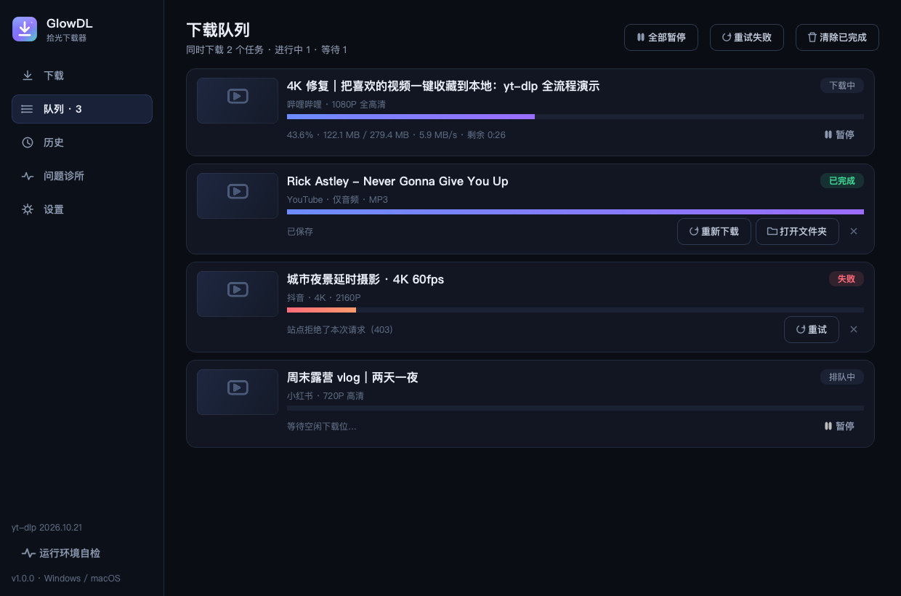
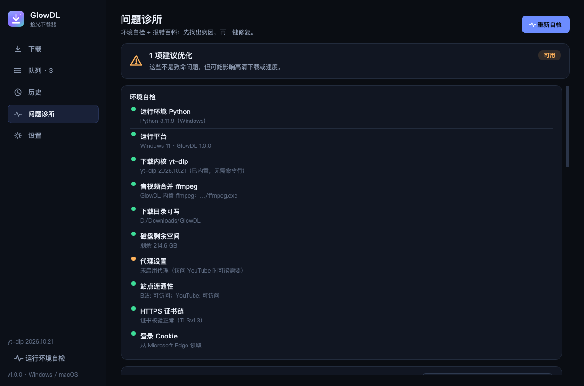
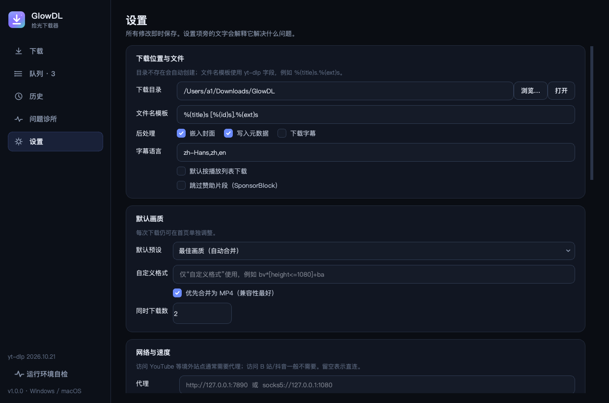
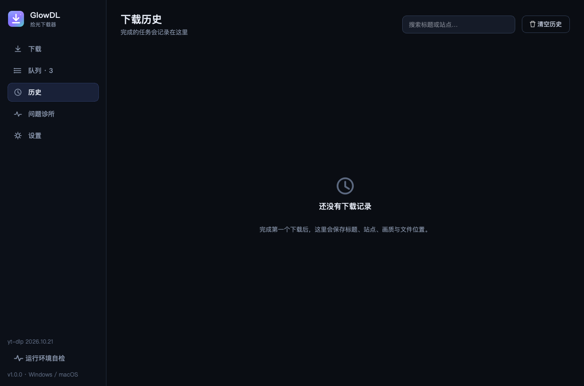
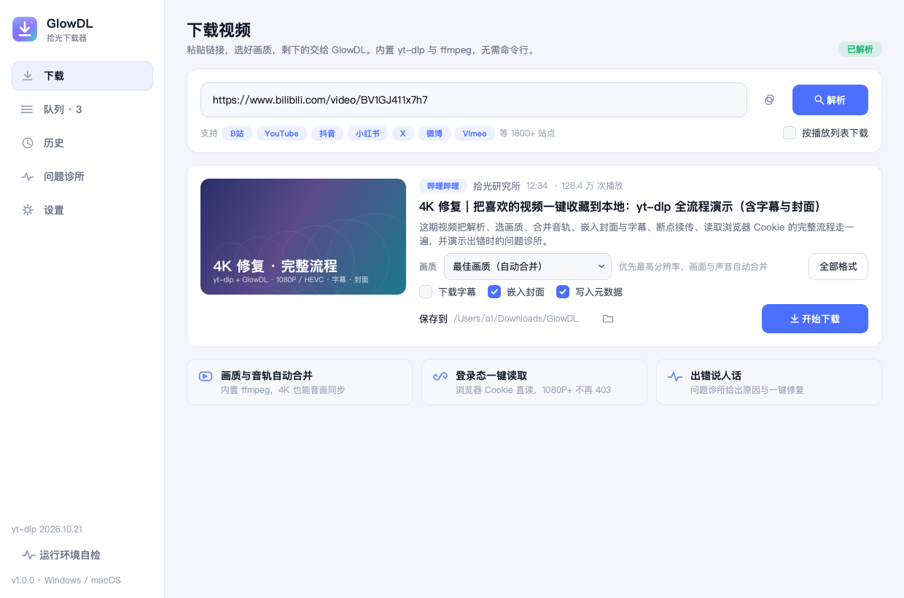
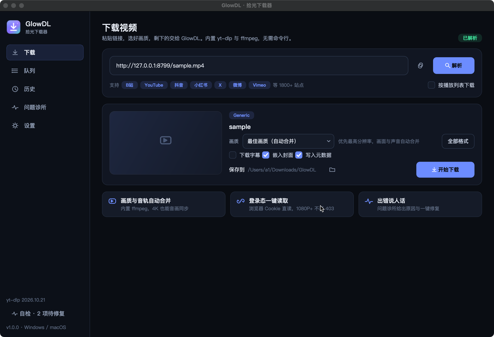
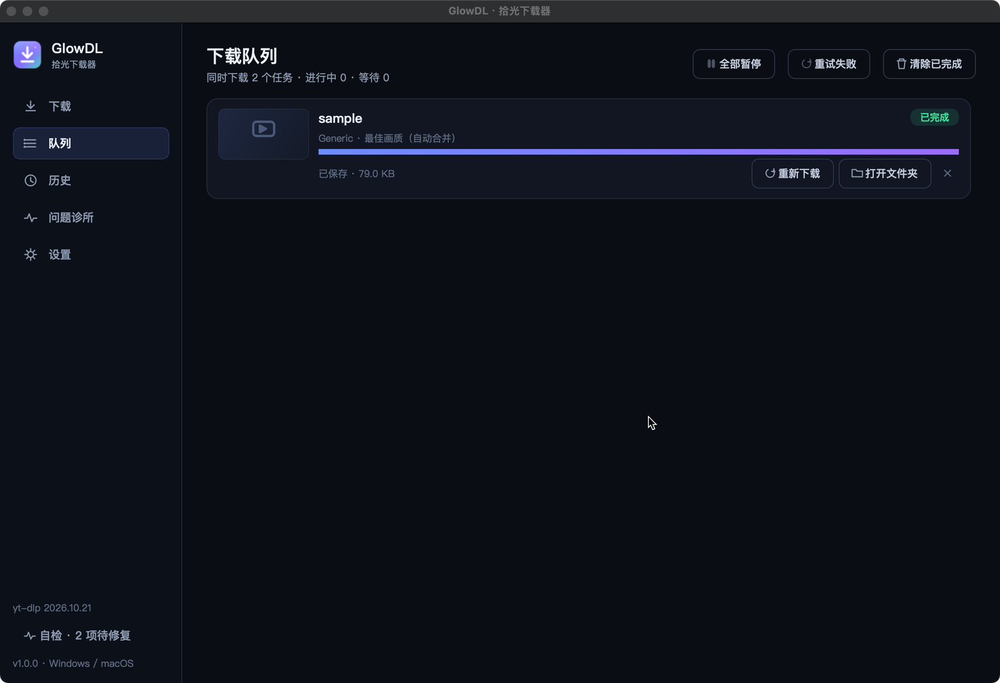
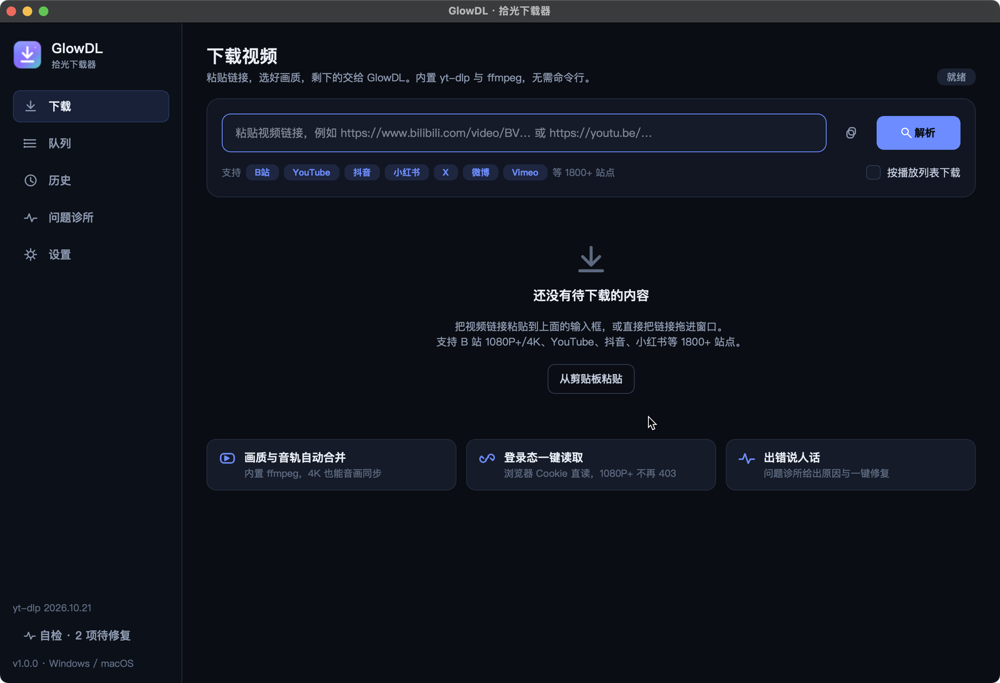

# GlowDL · 拾光下载器

> 以 [yt-dlp](https://github.com/yt-dlp/yt-dlp) 为内核的 Windows / macOS 桌面视频下载器。
> 把「装 Python、敲命令、单独编译 ffmpeg、手动导 Cookie、看不懂报错」这些坑，全部收进一个双击即用的窗口里。

<p align="center">
  
</p>


---

## 一、这是什么

**GlowDL** 不是另写一个下载引擎，而是给 yt-dlp 套上一个真正的桌面软件外壳：

- 内核能力 100% 来自 **yt-dlp**（1800+ 站点、持续更新的解析器）；
- 界面用 **PySide6 / Qt 6** 编写，**同一套代码同时产出 Windows 与 macOS 应用**；
- 针对知乎文章 [《yt-dlp 从入门到顺手：我把 B 站、YouTube、抖音视频一键下载到本地》](https://zhuanlan.zhihu.com/p/2045080302888939589)
  里提到的使用门槛与常见问题，逐条做了软件层解法（见第四节对照表）。

> 说明：知乎对未登录/非浏览器访问返回 403，正文无法直接抓取（尝试过网页抓取、移动 UA、无头浏览器、
> 开放 API 与存档服务）。第四节的痛点清单依据该文标题、检索摘要与 yt-dlp 社区长期高频问题整理，
> 每一条都能在软件里找到对应功能与代码位置，便于审查。

---

## 二、看一眼

| 下载页 | 下载队列 |
|---|---|
|  |  |

| 问题诊所（自检 + 报错百科） | 设置 |
|---|---|
|  |  |

| 历史记录 | 浅色主题 |
|---|---|
|  |  |

上表由 `scripts/preview_ui.py` 离线生成。下面两张是**打包后的 `.app` 实机运行**（不是设计稿）：
解析本地 HTTP 视频 → 入队下载 → 历史记录落盘。

| 实机：解析完成 | 实机：队列完成 |
|---|---|
|  |  |

---

## 三、功能

**下载**
- 粘贴链接即解析；支持拖拽、剪贴板、播放列表整体入队。
- 画质预设：最佳 / 4K / 2K / 1080P / 720P / 480P / 仅音频 MP3 / 仅音频 M4A / 自定义 format。
- 「全部格式」表格列出每一条流的编码、帧率、体积与 format id，双击复制。
- 并发队列（1–6 个同时下载）、实时进度 / 速度 / 剩余时间、暂停、重试、断点续传。
- 后处理开关：合并 MP4、嵌入封面、写入元数据、下载并嵌入字幕、SponsorBlock 跳赞助。
- 字号、文件名模板、下载目录、限速、重试次数、分片并发全部可调。

**跨平台**
- macOS：`GlowDL.app` / `.dmg`（PyInstaller + ad-hoc 签名）。
- Windows：`GlowDL.exe` one-dir 压缩包（附 `.ico` 图标、SmartScreen 说明）。
- 统一使用系统原生窗口、HiDPI、深浅两套主题、系统托盘通知。

**稳定性**
- 内置 **ffmpeg**（`imageio-ffmpeg` wheel），不再出现「找不到 ffmpeg / 无法合并音视频」。
- **浏览器 Cookie 直读**（Chrome / Edge / Firefox / Safari / Brave / Chromium / Opera / Vivaldi）+
  `cookies.txt` / Cookie-Editor JSON 导入与格式转换。
- 网络：代理、限速、重试、分片并发、User-Agent / Referer 覆盖、系统证书兜底（certifi）。
- **问题诊所**：10 项环境自检 + 24 条报错百科；错误会被翻译成中文并附「一键修复」按钮。
- **内核热更新**：应用内检查并更新 yt-dlp（打包版也可更新，无需重装 200MB 安装包）。
- 下载历史（标题 / 站点 / 画质 / 体积 / 时间）+ 一键定位文件。

---

## 四、第二个网站提到的问题 → GlowDL 的解法

| # | 文章/社区里的典型坑 | 传统 yt-dlp 做法 | GlowDL 的做法 | 代码位置 |
|---|---|---|---|---|
| 1 | 先装 Python、再 `pip install`，命令行劝退 | 命令行 | 双击即用的安装包，GUI 全中文 | `app/ui/main_window.py` |
| 2 | 下载 1080P 报「ffmpeg not found」，音画分离无法合并 | 手动下载 ffmpeg 并配置 PATH | `imageio-ffmpeg` 内置二进制，启动即用；诊所自动定位 | `app/core/ffmpeg_tools.py` |
| 3 | YouTube 提示 *Sign in to confirm you're not a bot* / 403 | 手动导 cookies.txt + `--cookies` | 设置页选浏览器即可直读登录态；也可导入 cookies.txt/JSON | `app/core/cookies.py`、`app/core/errors.py` |
| 4 | B 站 1080P+ / 4K / 大会员内容只有 480P | `--cookies-from-browser` 记不住 | 同一入口 + 画质预设自动提示需要登录 | `app/ui/pages/home_page.py` |
| 5 | 抖音/小红书直接解析失败、403 | 需要 UA / Referer / Cookie | 设置里可覆盖 UA、Referer，并读取浏览器 Cookie | `app/core/engine.py` |
| 6 | 格式 id 看不懂（137+140 是什么） | `-f` 表达式 | 画质下拉 + 全部格式表 + 自定义格式兜底 | `app/core/formats.py` |
| 7 | 下载一半断了要重来 | `.part` 文件 + 手动续传 | 暂停保留分片，重试自动续传（`continuedl`） | `app/core/tasks.py`、`app/core/engine.py` |
| 8 | 报错全是英文 traceback，不知道怎么办 | 搜索引擎逐字查 | 24 条错误规则翻译成中文，附原因与修复按钮 | `app/core/errors.py` |
| 9 | 站点改版后旧版本突然全挂 | `pip install -U yt-dlp` | 应用内「检查更新」，打包版下载 wheel 热更新内核 | `app/core/updater.py` |
| 10 | 下载慢、单线程、没有并发 | 默认单任务 | 队列 + 并发下载 + 分片并发 + 限速 | `app/ui/main_window.py` |
| 11 | 字幕、封面、元数据要背一堆参数 | `--embed-thumbnail --embed-subs ...` | 三个勾选框 | `app/core/engine.py` |
| 12 | 下载完找不到文件 | 去目录里翻 | 历史记录 + 打开文件夹 + 完成后自动打开 | `app/core/history.py` |
| 13 | 代理要写环境变量 | `--proxy` | 设置页持久化代理并对所有请求生效 | `app/core/settings.py` |
| 14 | 中文/特殊字符文件名在 Windows 上乱码或报错 | 手动改模板 | 文件名安全清洗 + 模板校验 + 重名自动编号 | `app/core/paths.py` |
| 15 | 播放列表要一条条下 | 自己写脚本循环 | 播放列表一键整体入队 | `app/ui/main_window.py` |

更细的「现象 → 原因 → 修复」对照见 [`docs/问题诊所.md`](docs/问题诊所.md)。

---

## 五、快速开始

### 方式 A：用打包好的安装包

**macOS**

1. 下载 `GlowDL-1.0.0-macOS.dmg`，拖入「应用程序」。
2. 首次打开若提示「无法验证开发者」：右键 → 打开（本仓库用的是 ad-hoc 签名，未做 Apple 公证）。
3. 直接粘贴链接开始下载。

**Windows**

1. 解压 `GlowDL-1.0.0-Windows-x64.zip` 到任意目录（不要放在 `C:\Program Files`，避免无写权限）。
2. 双击 `GlowDL.exe`。
3. 若 SmartScreen 拦截：更多信息 → 仍要运行。

> 也可以直接 `python -m app.main` 从源码运行，见方式 B。

### 方式 B：从源码运行（开发/审查）

```bash
git clone <this-repo> glowdl && cd glowdl
python3 -m venv .venv
source .venv/bin/activate          # Windows: .venv\Scripts\activate
pip install -r requirements.txt

python -m app.main                 # 启动 GUI
python -m app.main --diagnose      # 环境自检（命令行）
python -m app.main --cli "URL" -q 1080 -o ~/Downloads/GlowDL   # 无界面下载
```

要求：Python 3.9+（推荐 3.10/3.11），Windows 10+ / macOS 11+。

---

## 六、使用流程

1. **粘贴**：把视频链接贴进输入框（或点右边的复制图标读剪贴板、或直接把链接拖进窗口）。
2. **解析**：稍等 1–3 秒，显示封面、标题、UP 主、时长、播放量。
3. **选画质**：默认「最佳画质（自动合并）」。想只要音频就选「仅音频 · MP3」。
4. **开始下载**：任务进入「队列」；完成后可在「历史」里定位文件。

需要登录才能看的（B 站 1080P+、YouTube 人机验证、抖音私密内容）：
**设置 → 登录态 Cookie → 选择你已登录的浏览器**，然后回下载页重试。

出问题时：**问题诊所 → 重新自检**，或在失败卡片上直接点「重试 / 读取 Cookie / 更新内核」。

---

## 七、工程结构

```text
glowdl/
├── app/
│   ├── main.py                # GUI 入口（--cli / --diagnose / --version）
│   ├── cli.py                 # 无界面命令行
│   ├── core/                  # 纯 Python，零 Qt 依赖，可单测
│   │   ├── engine.py          # yt-dlp 封装：解析、下载、进度、取消
│   │   ├── formats.py         # 画质预设、format 选择器、格式表
│   │   ├── errors.py          # 报错 → 人话 + 修复动作（24 条规则）
│   │   ├── ffmpeg_tools.py    # 内置 ffmpeg 定位
│   │   ├── cookies.py         # 浏览器 Cookie / cookies.txt / JSON 转换
│   │   ├── settings.py        # JSON 配置（原子写入）
│   │   ├── history.py         # 下载历史
│   │   ├── diagnostics.py     # 10 项环境自检（并行）
│   │   ├── updater.py         # 内核热更新（PyPI wheel 解包）
│   │   ├── paths.py           # 目录、文件名清洗、人类可读单位
│   │   └── tasks.py           # 任务模型
│   └── ui/                    # PySide6 界面
│       ├── main_window.py     # 侧边栏 + 页面 + 队列调度 + 托盘
│       ├── theme.py           # 深/浅主题 QSS + 运行时生成箭头素材
│       ├── icons.py           # 全部图标用 QPainter 矢量绘制
│       ├── widgets.py         # 卡片/缩略图/Toast/图片异步加载
│       ├── workers.py         # QThread 工作线程
│       └── pages/             # 下载 / 队列 / 历史 / 问题诊所 / 设置
├── tests/                     # pytest：核心 58 项 + 本地 HTTP 真下载
├── scripts/
│   ├── build_macos.sh         # .app + .dmg
│   ├── build_windows.ps1      # .exe + zip
│   ├── glowdl.spec            # PyInstaller 配置
│   ├── make_icons.py          # 生成 PNG/ICNS/ICO
│   └── preview_ui.py          # 离线生成界面截图
├── docs/
│   ├── 问题诊所.md             # 痛点 → 解法完整对照
│   ├── 构建与发布.md           # 打包、签名、CI
│   └── superpowers/specs/     # 设计说明（架构/取舍/测试策略）
└── .github/workflows/build.yml# Windows + macOS 双平台 CI
```

**关键设计**：`app/core` 不 import PySide6，所有下载/解析/错误处理逻辑都能在无窗口环境下单测；
`app/ui` 只负责渲染与交互。这样既保证可测试性，也让 CLI 与 GUI 共用同一套引擎。

---

## 八、测试与验证

```bash
# 全部测试（含本地 HTTP 真实下载、取消、音频转码）
.venv/bin/python -m pytest -q

# 只要有网络的真实站点测试（默认不在测试集里，避免 CI 依赖外网）
python -m app.main --diagnose
```

当前结果：

- **58 项测试全部通过**（单元 + 本地集成 + GUI 冒烟）。
- 本地 HTTP 集成测试会用 ffmpeg 生成一段真实 mp4，经 `engine.download()` 下载、转 MP3、并验证取消后
  `.part` 文件保留。
- `scripts/preview_ui.py` 可在无网络、无窗口环境下重新生成 `docs/screenshots/` 里的全部界面截图。

复现截图：

```bash
QT_QPA_PLATFORM=offscreen .venv/bin/python scripts/preview_ui.py docs/screenshots
```

---

## 九、打包

```bash
# macOS → dist/GlowDL.app + dist/GlowDL-1.0.0-macOS.dmg
bash scripts/build_macos.sh

# Windows → dist/GlowDL/GlowDL.exe + dist/GlowDL-1.0.0-Windows-x64.zip
powershell -ExecutionPolicy Bypass -File scripts\build_windows.ps1
```

GitHub Actions 已配置双平台矩阵，推送 tag 即可在 Actions 里下载三个产物（mac dmg / win zip）。
细节与签名/公证、SmartScreen 说明见 [`docs/构建与发布.md`](docs/构建与发布.md)。

---

## 十、审查指引（给 reviewer）

建议按下面顺序验收，大约 10 分钟：

| 步骤 | 命令 / 操作 | 预期 |
|---|---|---|
| 1 | 双击 `dist/GlowDL.app`（或 `python -m app.main`） | 2 秒内出现首页，无控制台窗口 |
| 2 | 粘贴任意 B 站视频链接 → 解析 → 开始下载 | 出现封面/标题；队列出现进度、速度、剩余时间 |
| 3 | 设置 → 登录态 Cookie → 选择已登录浏览器 → 重试 1080P | 原本 480P 的视频可下 1080P+ |
| 4 | 问题诊所 → 重新自检 | 10 项检查 6 秒内出结果；有问题的项带「修复」 |
| 5 | 断网状态下粘贴链接 | 出现中文错误卡片 + 重试/配置代理按钮，而不是 traceback |
| 6 | `pytest -q` | 58 passed |
| 7 | `bash scripts/build_macos.sh` | 重新产出 `.app` 与 `.dmg` |

**本仓库已在本机验证**：macOS 15 / Python 3.10.11 上完成打包与实机下载（见上方「实机」截图），
本地 HTTP 视频经 GUI 解析 → 下载 → 历史落盘全链路通过。



**已知限制（如实说明）**

- **Windows 未做本机实机打包**：PyInstaller 不能交叉编译，仓库提供 `scripts/build_windows.ps1`
  与 GitHub Actions `windows-latest` 矩阵；Windows 专属路径/编码逻辑已由单测覆盖，但没有在真机截图。
- 未做 Apple 公证与 Windows 代码签名，首次打开需要右键/“仍要运行”。
- 界面文案以中文为主；`设置 → 错误提示语言` 目前影响错误/预设文案，完整 i18n 未做。
- 播放列表按“逐条加入队列”处理，不是单个聚合任务；直播录制暂未支持。
- 知乎原文返回 403，无法逐字核对；痛点清单来源见本文开头与 `docs/问题诊所.md` 的说明。

## 十一、合规与免责声明

- GlowDL 不提供、不内置任何账号，**不破解 DRM、不绕过付费墙**；遇到 DRM/会员内容会明确提示并停止。
- 请仅下载**你有权保存**的内容（自己的作品、CC 授权、明确允许离线保存的资源等），
  并遵守目标站点的服务条款与所在地法律。
- 软件按 MIT 协议开源，不提供任何担保。

## 十二、致谢与许可

- 内核：[yt-dlp](https://github.com/yt-dlp/yt-dlp)（Unlicense），本仓库通过 PyPI 依赖方式使用。
- FFmpeg 二进制：[imageio-ffmpeg](https://github.com/imageio/imageio-ffmpeg)（BSD-2-Clause）。
- 界面：Qt 6 / PySide6（LGPLv3）。
- 本项目代码：MIT，见 [LICENSE](LICENSE)。
